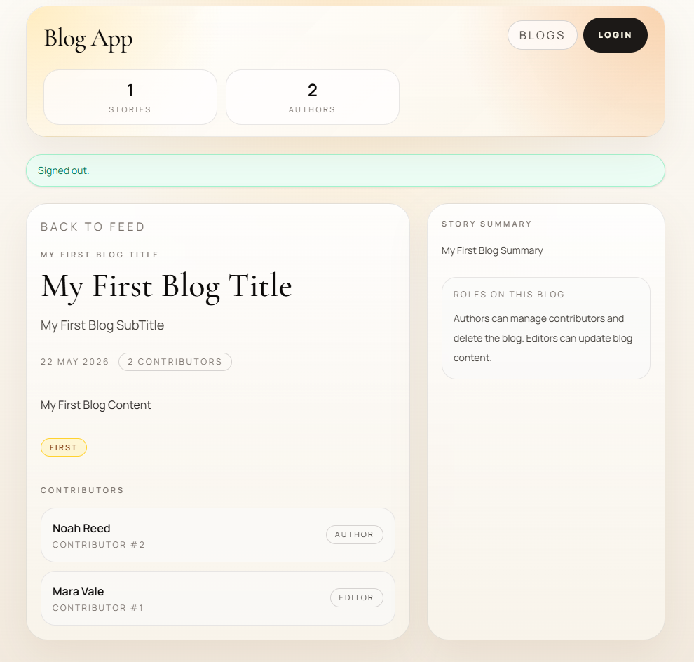
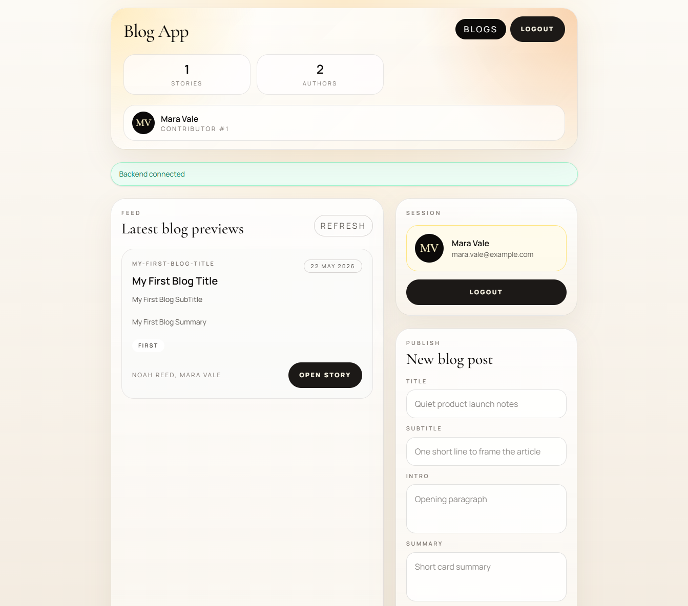
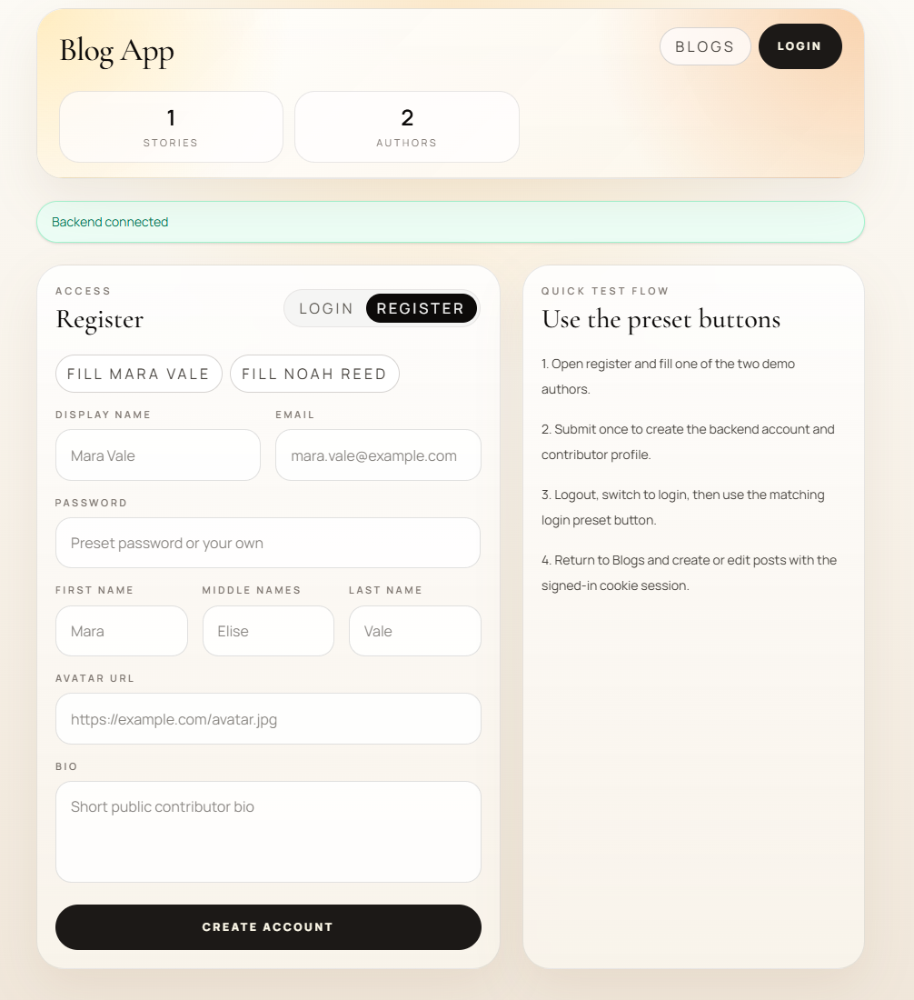

# dotnet-react-blog-app

Simple full-stack blog app with ASP.NET Core backend, React frontend, cookie auth, SQLite and Docker Compose.

## Preview



### Home



### Register




## Quick app summary

- public blog feed
- public blog detail
- register
- login
- logout
- current user session check
- create blog
- edit blog
- delete blog
- add blog contributor
- update contributor role on blog
- remove contributor from blog
- list contributors
- contributor detail

## Contains

- `Blog.Api`
  - ASP.NET Core minimal API
  - Entity Framework Core
  - SQLite
  - cookie authentication
  - blog and contributor management
- `Blog.React`
  - React
  - Vite
  - Tailwind CSS
  - mobile-friendly blog feed and blog detail UI
  - login and register screens connected to backend
- `docker-compose.yml`
  - frontend container
  - backend container
  - SQLite persisted through Docker volume

## Auth

- cookie-based auth
- no JWT
- backend returns auth cookie on register and login
- frontend sends requests with credentials

## Database

- SQLite
- default local file: `BlogStore.db`
- in Docker: `/data/BlogStore.db`
- migrations run on backend startup

## Docker

- frontend runs on `http://localhost:5173`
- backend runs on `http://localhost:{port}`
- start both with one command:

```bash
docker compose up --build
```

## Env files

Root `.env`:

```env
VITE_PORT=
VITE_PROXY_TARGET=
```

React local `.env` in `Blog.React/.env`:

```env
VITE_PORT=
VITE_PROXY_TARGET=
```

Templates are included:

- `.env.example`
- `Blog.React/.env.example`

## Project init

### Clone

```bash
git clone https://github.com/kamesprojects/dotnet-react-blog-app.git
cd dotnet-react-blog-app
```

### Prepare env

```bash
copy .env.example .env
copy Blog.React\\.env.example Blog.React\\.env
```

If you are on bash:

```bash
cp .env.example .env
cp Blog.React/.env.example Blog.React/.env
```

## Run with Docker

```bash
docker compose up -d --build
```

Open:

- frontend: `http://localhost:5173`
- backend: `http://localhost:5270`

### Stop Docker

Stop containers only:

```bash
docker compose stop
```
Stop and remove containers and network:
```bash
docker compose down -v
```

## Run without Docker

Backend:

```bash
cd Blog.Api
dotnet watch
```

Frontend:

```bash
cd Blog.React
npm install
npm run dev
```
